# ForceTrace · 力迹

> 基于 Flutter 与 AI 视觉的 VBT（Velocity-Based Training）健身辅导记录应用。
> 实时骨骼 · 杠铃轨迹 · 速度损失 · 组后报告，把「重量 × 次数」升级为「速度 × 质量」。

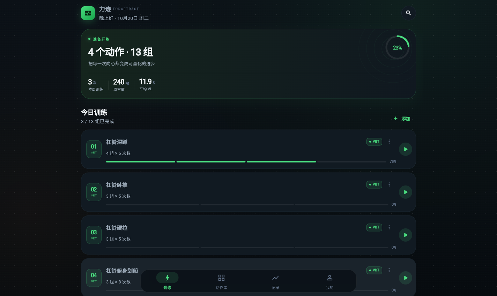

| 实时 VBT HUD | 组后报告 |
| --- | --- |
| 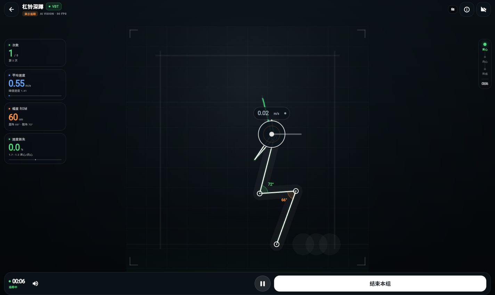 | 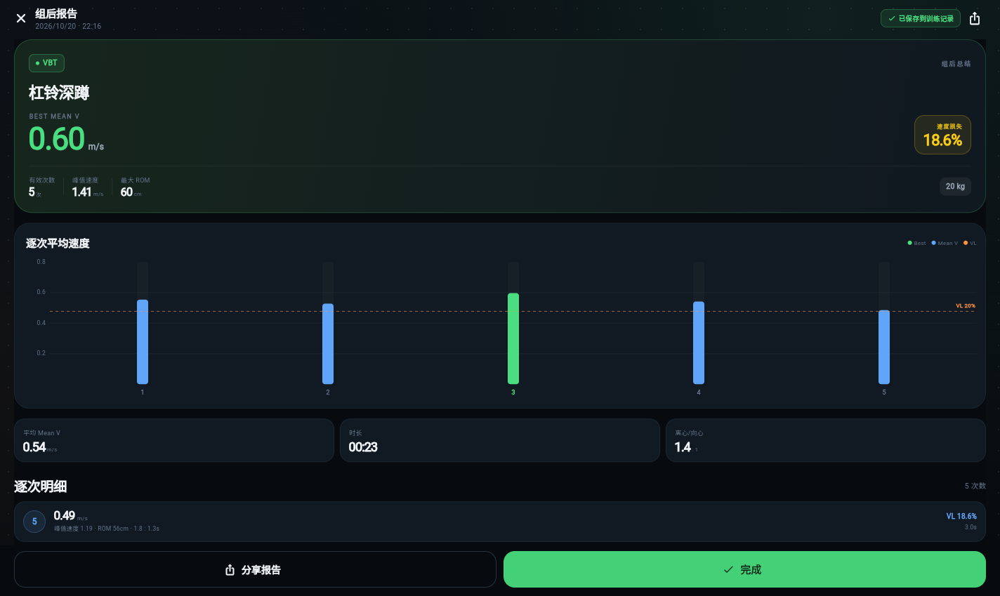 |

| 动作库 | 动作详情 |
| --- | --- |
| 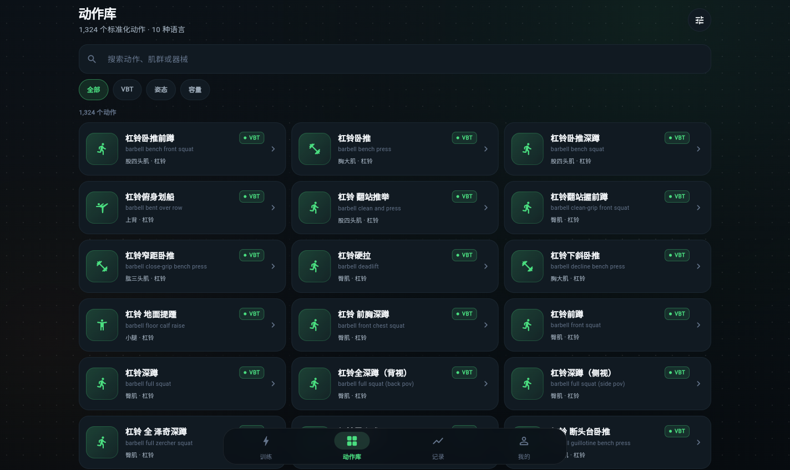 | 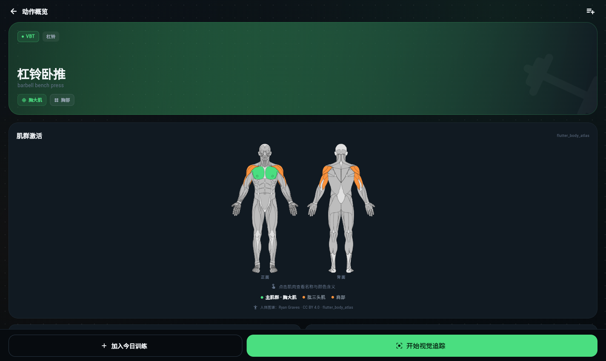 |

| 空间标定 | 训练记录 |
| --- | --- |
| 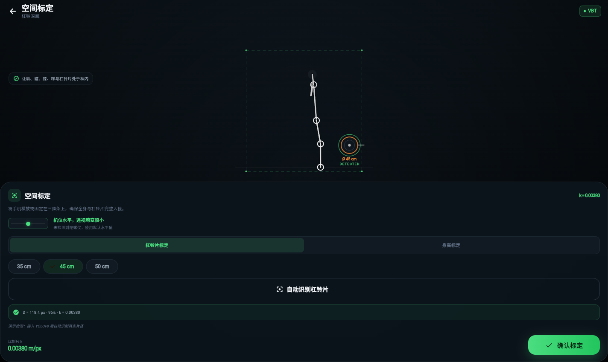 | 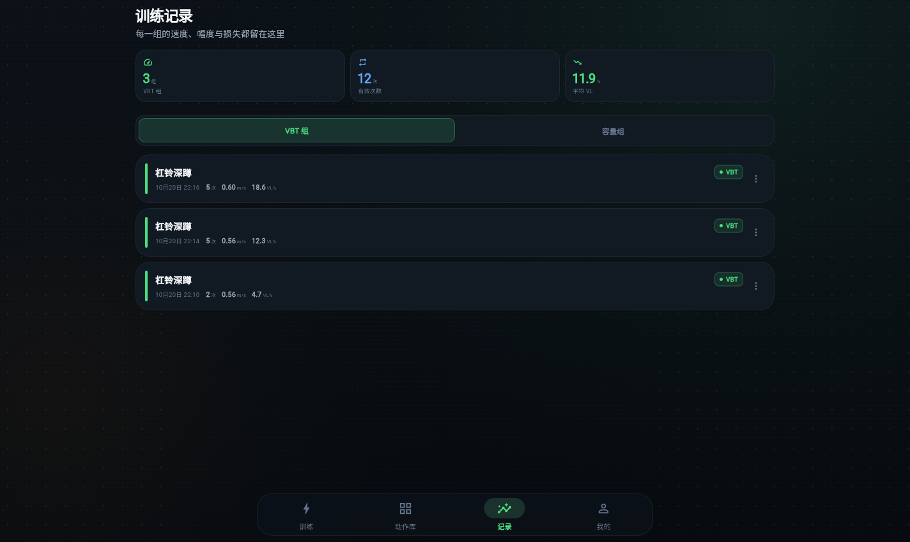 |

| Android 首页 | Android 动作库 |
| --- | --- |
| 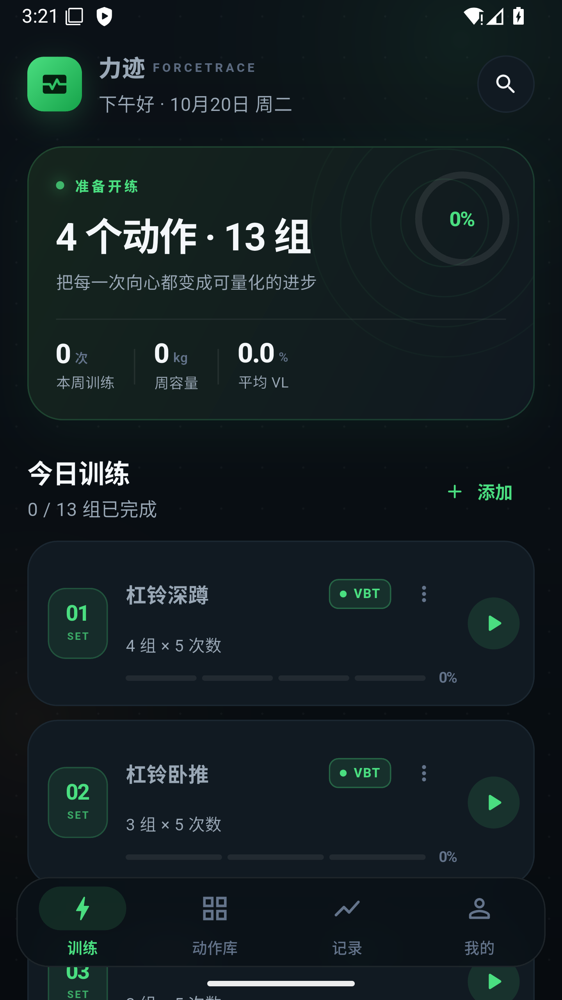 | 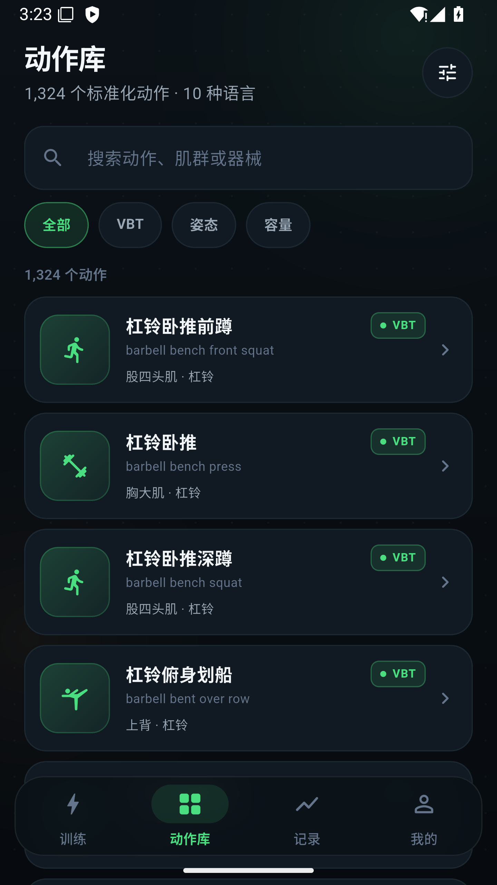 |

| 真机动作详情 | 真机实时 HUD | 真机组后报告 |
| --- | --- | --- |
| 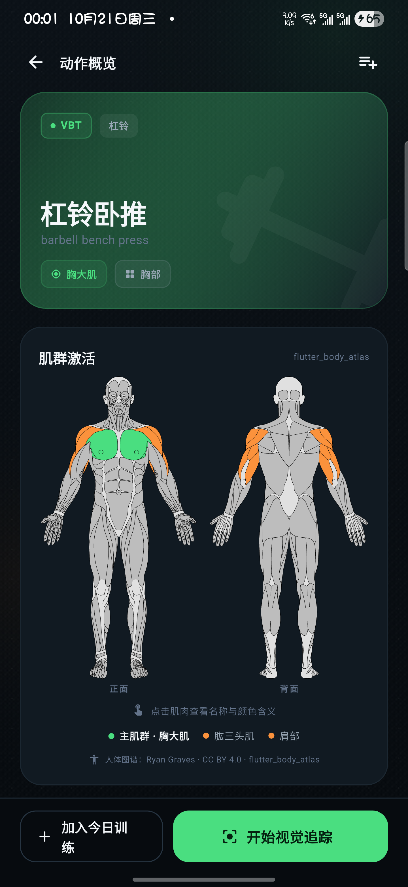 | 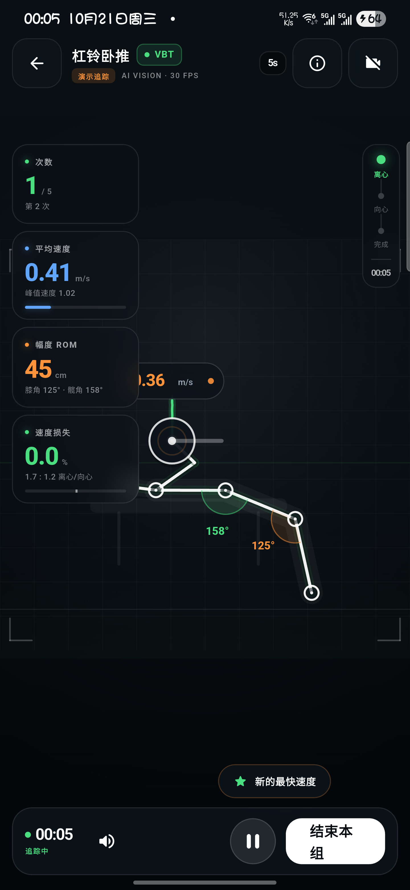 | 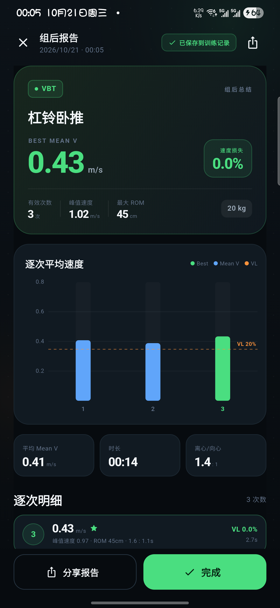 |

## 1. 功能一览

| 模块 | 能力 |
| --- | --- |
| 动作库 | 内置 1,324 个标准化动作，支持中/英名称、肌群/器械/部位检索，筛选面板支持点击正反面人体模型选择部位、联动高亮与实时结果数，10 种语言的分布教程，三级视觉等级（Tier 1 / 2 / 3） |
| 动作详情 | 顶部动作图片/GIF 切换预览、`flutter_body_atlas` 交互式 SVG 肌群图谱（正面/背面、主/协同肌高亮、点击查看）、逐语言步骤、器械与目标肌群、加入今日训练 |
| 今日训练 | 计划组数/次数/重量、完成进度、快速开始、从动作库批量添加 |
| 实时 HUD | Android/iOS ML Kit 真实姿态推理（Web 模拟回退）、**默认前置摄像头**/可切换后置、全屏相机预览、骨架锚点与连线、髋/膝角度扇形、双色参考点轨迹、跟随速度胶囊、左侧四宫格毛玻璃仪表盘、阶段轨、语音/震动提示 |
| 空间标定 | 标准 45/35/50 cm 杠铃片自动识别、身高标定、陀螺仪倾角检测、机位引导框 |
| 运动学 | One-Euro 滤波、四态重复状态机、瞬时/平均/峰值速度、ROM、离心/向心节奏、速度损失 VL、最佳次数 |
| 组后报告 | fl_chart 逐次平均速度柱状图、VL 阈值线、最佳次数标记、逐次明细、PNG 分享 |
| 容量记录 | Tier 3 固定器械/绳索动作的重量 × 次数 × RPE 记录与组间休息倒计时 |
| 训练历史 | VBT 组与容量组双视图、累计次数/平均 VL、删除与回看 |
| 设置 | 中/英界面、语音开关、VL 停组阈值、默认片径、身高、演示数据重置 |
| 数据库 | Drift (SQLite)：动作、教程、训练组、逐次记录、容量组、今日计划、元数据 |

## 2. 快速开始

环境：Flutter **3.47+ / Dart 3.13+**（已在 Flutter 3.47.7 验证）。

> Windows 桌面平台需要开启 Developer Mode 以支持插件符号链接；本项目的主要目标平台是 Android / iOS / Web。移动端构建可使用 `flutter build apk --no-pub`（依赖已解析时），避免 Windows 符号链接步骤。

```bash
flutter pub get
flutter run -d chrome
```

中国大陆网络建议先切换镜像：

```powershell
$env:PUB_HOSTED_URL="https://pub.flutter-io.cn"
```

### Web 构建

```bash
flutter build web --release --no-wasm-dry-run
python -m http.server 8080 --directory build/web
# 打开 http://localhost:8080
```

- `web/sqlite3.wasm` 与 `web/drift_worker.js` 已随仓库提供，是 Drift 在浏览器中运行 SQLite 的必需文件。
- 摄像头需要在 `localhost` 或 HTTPS 下使用；浏览器未授权时会自动停留在演示舞台。
- 首次启动会把 `assets/db/initial_exercises.db.gz`（1.69 MB）解压并直接挂载：Web 端通过 drift 的 WASM 运行时初始化 IndexedDB，原生端复制到应用文档目录。预置库已经包含 1,324 个动作与 10 语言教程，不再逐行灌入。

### Android / iOS

Android 已在 **Samsung SM-S9280（Android 15 / API 35）** 和 **SM-G9650（Android 10 / API 29）真机** 以及 Android 16 / API 36 x86_64 模拟器上验证。真机覆盖数据库挂载、1,324 动作库、`flutter_body_atlas` 正/背图与点击、前置/后置摄像头切换、ML Kit Pose 原生推理、竖放/水平标定、空间标定与倾角传感器、HUD、组后报告保存；模拟器覆盖核心导航、库/详情与多语言教程。

```powershell
$env:ANDROID_HOME="D:\Android\Sdk"
$env:JAVA_HOME="D:\Android\Android Studio\jbr"
$env:FLUTTER_STORAGE_BASE_URL="https://storage.flutter-io.cn"
flutter build apk --release
adb install -r dist\force-trace-1.0.0-release.apk
```

- 构建产物：[dist/force-trace-1.0.0-release.apk](dist/force-trace-1.0.0-release.apk)，111.2 MB，debug 签名，可直接侧载安装；已包含 ML Kit 姿态模型（`assets/mlkit_pose`），推理可离线运行。
- SHA-256：`CF9B65221C044804A19147133F4C1CED8E9CC719A0C7E1AAA92BA01283D6832A`
- Release 关闭了 R8/资源压缩：`shared_preferences 2.5.x` 的 Pigeon JNI 方法会被 R8 裁掉，导致启动时 `NoSuchMethodError`。正式上架请配置自己的签名，并改用 keep 规则或等待上游修复。

#### 真机调试记录（2026-10-21）

- `flutter run -d R5CX10EBLJM --debug`，设备 SM-S9280 / Android 15 / arm64 / 1440×3120，VM Service 与 DevTools 正常连接。
- 真机 HUD 首次运行触发 `Container` 负 margin 断言（`margin.isNonNegative`）；将 `GlassStatCard` 进度标记改为 `Positioned(top: -2)`。
- 设置页 About 卡片的 `ListTile` 缺少 Material 祖先，补 `Material(type: MaterialType.transparency)` 消除 ink 警告。
- 完成一次 3 次卧推组：0.43 m/s 最佳平均速度、45 cm ROM，报告成功保存到训练记录。

iOS 需要 macOS + Xcode，当前环境未构建：

```bash
flutter build ios --release
```

相机权限已写入（Android `CAMERA`、iOS `NSCameraUsageDescription`）。

#### Android 构建备注（本机网络）

- Gradle 9.3.1 使用腾讯镜像下载，`distributionSha256Sum` 校验官方包。
- Maven 优先使用阿里云 `google` / `public` / `gradle-plugin` 镜像，官方仓库兜底。
- Flutter Gradle 插件是 included build，项目级仓库配置无法覆盖；本机额外使用 `~/.gradle/init.d/aliyun-mirrors.gradle` 的 `beforeSettings` 注入镜像（不属于仓库，换机器可删除）。
- 工程在 `F:`、pub cache 在 `C:`，Kotlin 增量缓存无法跨盘，故设置 `kotlin.incremental=false`。
- `sqlite3` 原生库通过 `gh-proxy.com` 下载，hook 仍会校验 pub.dev 中发布的 SHA-256。

## 3. 技术架构

```
┌────────────────────────────────────────────────────────────┐
│ Flutter UI：动作库 / 今日训练 / 实时 HUD / 报告 / 历史 / 设置 │
├────────────────────────────────────────────────────────────┤
│ Riverpod（页面数据） + ValueNotifier（30 Hz 热路径）          │
├────────────────────────────────────────────────────────────┤
│ VBT Domain：One-Euro → 运动学解算 → 四态状态机 → 汇总         │
│   · VbtSessionEngine（纯逻辑、可测试）                        │
│   · VbtEngineController（Timer + TTS + 震动）                 │
├────────────────────────────────────────────────────────────┤
│ PoseFrameSource：VisionPoseSource（ML Kit，Android/iOS）       │
│                   SimulatedPoseSource（Web / 无相机 / 回退）    │
│                   ↳ 杠铃 YOLOv8n 检测仍待接入                  │
├────────────────────────────────────────────────────────────┤
│ Drift / SQLite（WASM on Web，原生 FFI on Mobile/Desktop）     │
└────────────────────────────────────────────────────────────┘
```

### 目录

```
lib/
  app/                 MaterialApp、Provider 注入、启动引导
  core/                主题、中文/英文字符串、通用组件、格式化
  data/
    db/                Drift 表结构、幂等种子服务
    repositories/      动作、训练、计划、容量组查询
    settings/          SharedPreferences 设置
  domain/vbt/
    one_euro_filter.dart
    rep_state_machine.dart
    angles.dart
    calibration.dart
    exercise_profile.dart     动作 → 运动模式 / 最小 ROM / 提示
    simulated_pose_source.dart 7 种动作模式的确定性姿态源
    vbt_session_engine.dart
    vbt_engine_controller.dart
  features/
    today/ library/ live/ report/ records/ settings/ workout/ shell/
    library/widgets/muscle_map.dart  flutter_body_atlas 双视图肌群图谱与标签映射
  services/            camera_session.dart, tilt_service.dart
assets/db/           initial_exercises.db.gz（预置 SQLite，10 语言，1324 动作）
tool/                  build_exercises_dataset.py, make_icons.py
web/                   index.html, manifest, sqlite3.wasm, drift_worker.js
test/                  48 个单元/组件测试
```

### 关键算法

- **交互式肌群图谱**：使用 `flutter_body_atlas` 的稳定 SVG 肌肉 ID 和 `ColorMapper`，把数据集里的 `target` / `secondary_muscles`（如 `quads`、`delts`、`upper back`）映射到具体肌肉路径；正面/背面双视图、主肌群绿色、协同肌群橙色，支持点击与 hover 查看名称。
- **One-Euro Filter**：低速强平滑、高速自适应提高截止频率，避免峰值速度被削峰。
- **像素 → 米**：`k = D_real / D_pixel`；标准 45 cm 奥运片，也支持 35/50 cm 或身高标定。
- **瞬时速度**：相邻滤波帧位移 × k / Δt；垂直速度带符号，用于阶段判断。
- **髋/膝关节角**：向量点积反余弦；HUD 在关节处绘制扇形与整数值。
- **四态状态机**：`IDLE → ECCENTRIC → CONCENTRIC → COMPLETED`，向下 0.06 m/s 持续 150 ms 启动离心、转向上持续 60 ms 启动向心、回顶低于 0.05 m/s 持续 120 ms 结算；ROM 未达阈值不计次。
- **速度损失**：`VL = (best Mean V − Mean Vₙ) / best Mean V × 100%`；达到阈值可自动停组。

## 4. 数据与版权

- 动作数据来自 [`hasaneyldrm/exercises-dataset`](https://github.com/hasaneyldrm/exercises-dataset)，共 1,324 个动作、10 种语言教程。
- 动作预览根据已有 `id` / `media_id` 按需读取上游的 180×180 缩略图和 GIF，默认显示静态图片，点击「动图」后播放，不向安装包打包媒体；无网络时显示重试入口。媒体署名保留在预览下方，使用条款见上游 [媒体说明](https://github.com/hasaneyldrm/exercises-dataset/blob/main/NOTICE.md)。
- 人体肌群图谱使用 [`flutter_body_atlas`](https://pub.dev/packages/flutter_body_atlas)（BSD-3-Clause）；其 SVG 解剖图层基于 [Ryan Graves 的作品](https://www.figma.com/community/file/1320468164820924031)，采用 [CC BY 4.0](https://creativecommons.org/licenses/by/4.0/) 许可，并为交互命中测试修改了元素 ID。应用内动作详情页与「设置 → 关于」均保留了署名。
- 中文动作名由关键词短语表生成，旗舰动作有人工覆盖；其余长尾动作可能出现直译感。
- 重新生成离线资产：

```bash
python tool/build_exercises_dataset.py --source /path/to/exercises.json
# 输出 assets/db/initial_exercises.db.gz（约 1.7 MB）
```

该脚本会完成：语言裁剪、中文名生成、Tier 分级（杠铃复合动作 → Tier 1；自由重量/自重 → Tier 2；固定器械/绳索/有氧 → Tier 3）、gzip 压缩。

## 5. AI 视觉与模拟回退

实时链路已经接入 **Android/iOS 的 ML Kit Pose Landmarker**（`google_mlkit_pose_detection 0.16.1`）：

- 相机请求 **15 FPS**；`camera.startImageStream` → **最多 15 FPS 的推理节流** → NV21/YUV420 转换 → ML Kit 33 个关键点 → `PoseFrame`。多余帧在转换和推理前丢弃，无积压队列；实际采集帧率取决于设备支持；
- 进入视觉追踪页默认申请并开启前置相机；标定与开始训练会等待初始化完成。用户仍可手动关闭或切换相机；权限拒绝或无相机时保留演示回退；
- 首次识别选择可见且置信度较高的一侧，并在本次跟踪期间固定左右身份与参考点，避免逐帧切侧或遮挡时从双侧中点跳到单侧。参考点：深蹲/俯卧撑取该侧肩；卧推/推举/硬拉/弯举取该侧手腕；引体取该侧髋；
- 双侧骨架与参考点均在归一化坐标上做 One-Euro 滤波，避免像素尺度放大导数后使滤波失效；HUD 的 30 Hz 轮询只处理新时间戳，速度按真实采样间隔计算，支持低帧率；
- 暂停、后台和结束训练时不再调用姿态模型；身高标定最多 **6 FPS**，片径演示标定不运行姿态模型。短暂遮挡保留最近的有效姿态，**500 ms** 后失效，重新识别时重置滤波和未完成动作，避免速度突跳；
- 相机模式使用 100% 相机预览；HUD 只保留顶部/底部渐变压暗，不再叠加大面积黑色蒙层；
- 真实姿态的骨骼、轨迹与速度胶囊按相机 `BoxFit.cover` 变换和 ML Kit 图像尺寸映射到屏幕，避免骨架缩在合成正方形舞台内导致错位；前置全景会同时绘制左右两侧骨架，不再只画单侧；
- **关键修正**：`google_mlkit_pose_detection` 在 Android 上返回的是**图像像素坐标**而非 0~1 归一化坐标；适配器先按旋转后的图像尺寸（如 480×720）归一化，再做前置镜像。此前直接 clamp 到 0~1 会让所有关节塌缩到 `(0,1)`，表现为骨架消失或严重错位；
- 身高标定在标定页直接启动相机 + ML Kit：全身入镜后读取鼻-踝像素高度生成真实比例尺，未检测到完整身体时不允许真实身高确认；此时可点「使用默认标定」用 45 cm 默认比例尺继续，避免卡在标定页。标定同时支持**水平放置**与**竖放（portrait）**，真机竖放读数已验证。
- HUD 显示 `ML KIT` / `≤15 FPS`；相机未开启、Web、或 ML Kit 不可用时回退到确定性的 `SimulatedPoseSource`，界面显示「演示追踪」。

仍然存在的边界：

- **没有杠铃端面 YOLOv8/ByteTrack**，因此“杠铃速度”实际是手腕/肩部/髋部参考点的近似速度，不是严格杠铃中心速度；
- 标定页的杠铃片“自动识别”仍是演示数据（120 px），没有真实片径检测；身高标定只在全身可见时真实生效；
- ML Kit 使用原生推理，但相机帧仍经过 Dart/Platform Channel，不是 PRD 要求的原生零拷贝/FFI；
- iOS 需要 iOS 15.5（ML Kit 要求），当前未在 macOS/Xcode 构建；
- 姿态模型已随 APK 打包（`assets/mlkit_pose`），不依赖联网下载；旧机型的 ML Kit 加速基准子进程可能记录兼容性崩溃，主推理进程仍继续。

接入真正的杠铃双通道时，新增一个 `PoseFrameSource`（输出关键点 + 杠铃中心 + 真实片径）即可，`VbtSessionEngine`、HUD、报告与数据库不需要改动。

> 完整的需求逐项对照与剩余缺口见 [docs/requirements-audit.md](docs/requirements-audit.md)。

## 6. 验证

```bash
flutter analyze          # No issues found
flutter test             # 48 tests passed
flutter build web --release --no-wasm-dry-run
```

测试覆盖：

- One-Euro 收敛、抖动抑制、阶跃响应、重置；
- 15 FPS 节流、双侧骨架与参考点稳定性、旧帧去重、10/15 FPS 计次与速度、跟踪批次重置、暂停/后台停推理、过期姿态与退出时的迟到结果；
- 关节角、角度格式化、FPS 统计；
- 肌群映射：胸/背/腿/臂/臀/核心到 `flutter_body_atlas` 稳定肌肉 ID 的转换；
- 四态状态机：完整深蹲、幅度不足、只有向心、连续两次；
- 7 种动作模式的最小 ROM / 模式映射；
- 预置 SQLite 与 Drift schema 一致、10 语言教程可读、今日计划幂等生成；
- 完整组模拟：多次有效动作、最佳次数、VL、自动停组、Tier 2 无杠铃模式；
- TierBadge 中英文渲染。
- 动作图片/GIF 切换与加载失败回退、320 px 窄屏按钮不换行、视觉追踪默认打开相机与初始化中退出页面。
- 人体区域分类、真实 SVG 点击筛选与再次点击取消、前后视图及标签高亮同步、与搜索/器械/视觉等级组合筛选、窄屏重置后搜索框同步清空。

## 7. 已知限制

1. **杠铃端面 YOLOv8 检测与真实片径自动标定未接入**；ML Kit 姿态已接入，速度是肩/腕/髋参考点的近似值（见第 5 节）。
2. iOS 未构建；Android release 使用 debug 签名且关闭 R8，适合本地安装验证，不适合直接上架；iOS 目标已提高到 ML Kit 要求的 15.5。
3. Web 首次启动需把 8.66 MB 的预置 SQLite 解压并写入 IndexedDB，首次会多花一点时间。
4. 报告分享使用浏览器 Web Share API；不支持文件分享的浏览器会降级为文本分享。
5. 动作中文名为规则生成，少数长尾动作可读性一般（例如 `3/4 sit-up` 显示为「34 仰卧起坐」）。
6. `flutter_body_atlas` 当前图层未包含竖脊肌、髂腰肌、前锯肌等少数肌群；这类目标不会高亮，但动作信息与教程仍完整展示。
7. 当前 Tier 数量为 **76 / 920 / 328**，PRD 写的是 45 / 250 / 1,029；分层规则尚未按新版文档重跑（见审计文档）。
8. ML Kit 姿态模型已随 APK 打包；在旧机型（如 Android 10/GMS 版本不匹配）上可能记录 ML Kit 加速基准子进程崩溃，主推理进程仍可继续，但需后续做机型兼容性测试。

---

**ForceTrace · 力迹** — 让每一次向心都变成可量化的进步。
